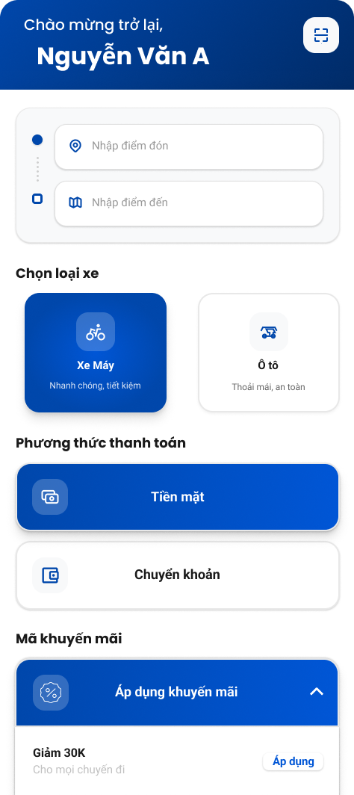
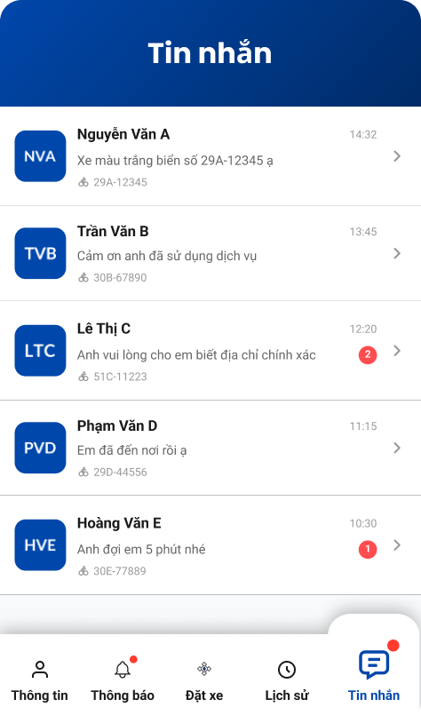
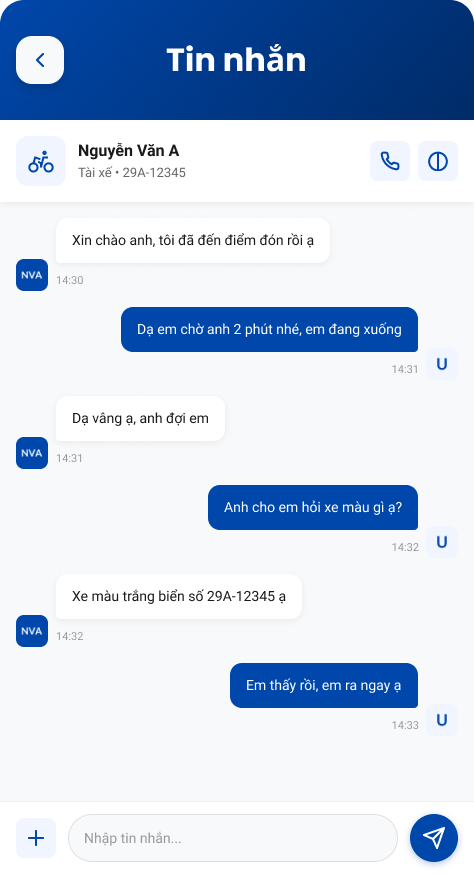
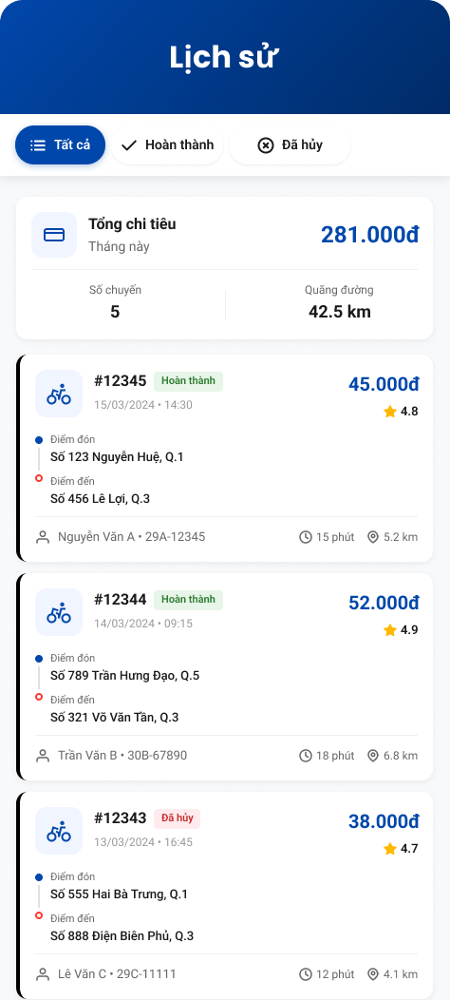
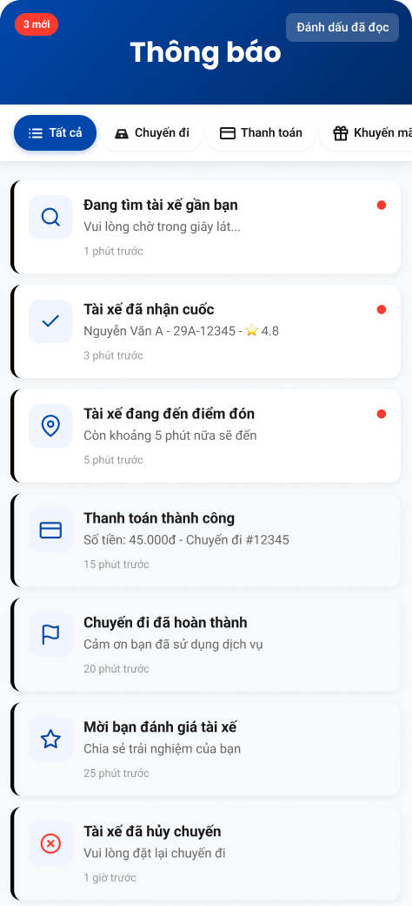
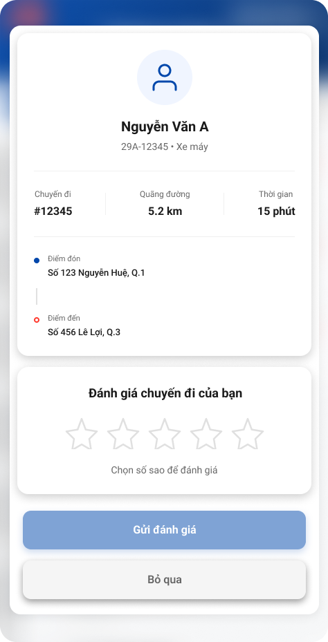

# 🚀 Movify – Mobile Ride-Hailing App

**Movify** is a mobile ride-hailing application project designed to provide users with a fast, convenient, and transparent transportation solution, especially in urban areas.

The application allows users to book rides, track routes in real time, estimate fares, and make flexible payments.

At the same time, this project helps the team gain hands-on experience in mobile application development while integrating commonly used features in modern ride-hailing platforms.

---

## 📸 Screenshots

| Ride Booking | Conversations | Real-time Chat |
|:---:|:---:|:---:|
|  |  |  |

| Trip History | Notifications | Trip Rating |
|:---:|:---:|:---:|
|  |  |  |

---

## 📌 Core Features

### 🔐 General Features
- User authentication & authorization (register, login, forgot password)  
- Profile management for customers & drivers  
- GPS positioning, map integration & driver matching  
- Realtime notifications  
- In-app messaging between customers and drivers  

---

### 👤 Customer Features
- Book rides (motorbike / car, pickup & destination selection)  
- Multiple payment methods (cash, e-wallet, bank)  
- Driver rating after trip completion  
- Trip history tracking  

---

### 🛵 Driver Features
- Payment setup (bank / e-wallet)  
- Trip history, ratings & income statistics  

---

### 🛠️ Admin Features
- Manage users, promotions and system data  
- System analytics & operational statistics  

---

## 🤖 AI Feature Proposals
- Automatic message translation based on user language  
- Smart route optimization (traffic, weather, conditions)  
- Dynamic pricing adjustment using AI  

---

## 🎯 Project Goals
- Practice real-world mobile app development  
- Integrate maps, realtime tracking & digital payment  
- Explore AI applications in transportation technology  
